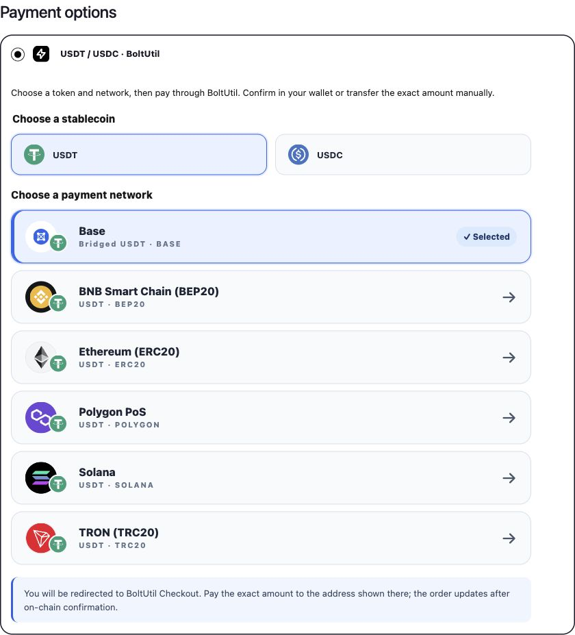
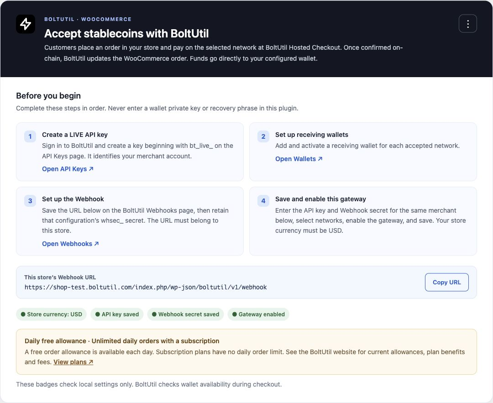
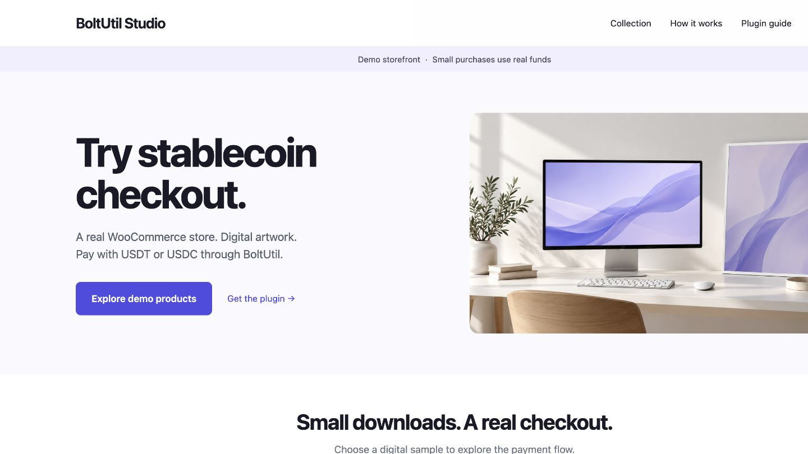

# BoltUtil Payments for WooCommerce

[English](README.md) · [简体中文](docs/i18n/README.zh-CN.md) · [Español](docs/i18n/README.es.md) · [Português](docs/i18n/README.pt-BR.md) · [Русский](docs/i18n/README.ru.md) · [Tiếng Việt](docs/i18n/README.vi.md) · [Türkçe](docs/i18n/README.tr.md) · [日本語](docs/i18n/README.ja.md) · [한국어](docs/i18n/README.ko.md) · [العربية](docs/i18n/README.ar.md) · [Français](docs/i18n/README.fr.md) · [हिन्दी](docs/i18n/README.hi.md)


**Accept USDT and USDC. Let customers pay their way.**

Customers choose a stablecoin and an available network in WooCommerce, then continue to BoltUtil Hosted Checkout. On supported devices and networks, a connected wallet fills in the receiving address and exact amount; the customer reviews and confirms the transaction. Manual transfer remains available. Funds go directly to the merchant’s configured receiving wallet.

**Plugin v0.6.1** integrates with BoltUtil’s multi-asset Hosted Checkout. The plugin version and BoltUtil service version are separate.

[**Download v0.6.1**](https://github.com/changye0413/boltutil-payments-for-woocommerce/releases/tag/v0.6.1) · [**Try the live demo**](https://shop-test.boltutil.com/) · [Integration guide](https://boltutil.com/woocommerce) · [Pricing](https://boltutil.com/pricing)

The demo shop sells small digital samples using **real funds**. Browsing is free; submitting a payment is a real transaction.

## Why BoltUtil

- **Two-step checkout:** choose USDT or USDC, then an eligible network. Works with classic checkout and Checkout Blocks.
- **Wallet confirmation or manual transfer:** payment methods are provided by BoltUtil Hosted Checkout. Quick-payment availability depends on the token, network, device and installed wallet.
- **Six networks, eleven supported combinations:** includes native USDC and explicitly labeled Bridged USDT on Base.
- **Verified order updates:** signed Webhooks plus a merchant-scoped API status check before completing a WooCommerce order. A browser return alone does not mark it paid.
- **Direct wallet settlement:** the plugin does not take custody or ask for wallet private keys or recovery phrases.
- **Twelve interface languages:** English and eleven bundled translations. [Language setup and translation maintenance](docs/I18N.md).
- **Daily free allowance:** subscription plans have no daily order limit. Current allowances, benefits and fees are defined on the [BoltUtil website](https://boltutil.com/pricing).

## See the checkout

### Choose a stablecoin, then a network




These are real interface screenshots from the demo store. They show selectable routes, not completed-payment evidence.

<details>
<summary>Merchant setup and the public demo storefront</summary>





</details>

## Supported tokens and networks

| Network | USDT | USDC |
| --- | --- | --- |
| TRON (TRC20) | USDT | — |
| Ethereum (ERC20) | USDT | Native USDC |
| BNB Smart Chain (BEP20) | USDT | Binance-Peg USDC |
| Polygon PoS | USDT | Native USDC |
| Solana | USDT | Native USDC |
| Base | **Bridged USDT** | **Native USDC** |

Availability requires an enabled BoltUtil service route, the merchant’s active receiving wallet and the plugin’s allowed-token/network settings. Upgrades retain USDT-only defaults until the merchant enables USDC. The invoice identifies the exact token variant; another token with a similar name is not interchangeable.

## Install v0.6.1

1. Download [`boltutil-payments-for-woocommerce-0.6.1.zip`](https://github.com/changye0413/boltutil-payments-for-woocommerce/releases/download/v0.6.1/boltutil-payments-for-woocommerce-0.6.1.zip) from the release. Verify it against the accompanying `SHA256SUMS.txt` if needed.
2. In WordPress, open **Plugins → Add New → Upload Plugin** and upload that installable ZIP. GitHub’s automatically generated source archives are not the install package.
3. Activate the plugin and follow the configuration below. Update the existing plugin in place; do not activate an older duplicate BoltUtil gateway folder.

**Requirements:** WordPress **7.0+**, PHP **7.4+**, WooCommerce **11.1+**, HTTPS and a WooCommerce store currency of **USD**. Automated compatibility checks cover WooCommerce 11.1, HPOS and Checkout Blocks; the public demo runs WooCommerce 11.2.0. Earlier WooCommerce versions are outside the declared support window.

BoltUtil is an external service. You need a LIVE `bt_live_` API key, a matching active Webhook and its `whsec_` secret, and receiving wallets configured in the same BoltUtil merchant account. Read the [service terms](https://boltutil.com/terms) and [privacy policy](https://boltutil.com/privacy).

## Configure in five steps

1. Set **WooCommerce → Settings → General → Currency** to **USD**.
2. Create a LIVE key in [BoltUtil API Keys](https://boltutil.com/dashboard/api-keys). Add and enable a receiving **address** for every intended network in [BoltUtil Wallets](https://boltutil.com/dashboard/wallets).
3. Open **WooCommerce → Settings → Payments → BoltUtil Payments** and copy the store-specific Webhook URL. Add it in [BoltUtil Webhooks](https://boltutil.com/dashboard/webhooks) for the same merchant account as the API key; save its Webhook secret.
4. Enter the LIVE API key and Webhook secret, choose allowed stablecoins and networks, enable the gateway, and save. Saved credentials are masked. Blank credential fields on a later save preserve their stored values.
5. Check an unpaid test order and Hosted Checkout amount/address/expiry. Complete a small real payment → callback → paid order → download or fulfillment acceptance test before normal live sales.

The plugin calls only `https://api.boltutil.com` for its payment API. Wallets and blockchain monitoring remain in BoltUtil.

## Payment correctness

The USD numeric order total is used as a stablecoin invoice basis; this version does not quote or lock a live exchange rate. **Pay the exact token amount displayed on Hosted Checkout**, which can differ from the WooCommerce total. Network fees are separate. Invoice totals must be at least USD 1; unsupported amount formats and precision beyond six decimal places are rejected.

```text
WooCommerce checkout → BoltUtil Hosted Checkout
  → connected-wallet confirmation or exact manual transfer
  → on-chain confirmation → signed Webhook → merchant-scoped status check
  → WooCommerce order paid → normal WooCommerce fulfillment
```

Event deduplication, matching payment/order/token/network/amount, signature freshness and verified API status protect order completion. Manual and scheduled status rechecks are available. Underpaid, unusual or late transfers require merchant review; returning to the shop does not prove payment. An expired attempt requires a new WooCommerce order. Base confirmation depends on L1 finality; no fixed confirmation time is promised.

## Release status and validation

v0.6.1 is an **early GitHub release**, also installed on the public demo store. Real-chain WooCommerce payment and production callback acceptance have **not yet been completed**. WordPress.org directory approval is not claimed.

- PHP 7.4 and 8.3 regression coverage: API signing/encryption, idempotency, route isolation, amount boundaries, signed Webhooks, duplicate events and reconciliation.
- Classic and Blocks JavaScript fixtures cover all eleven routes and token switching.
- Eleven PO/MO catalogs cover all 84 runtime PHP translation strings.
- Official Plugin Check on the submission candidate: **0 errors / 26 warnings**; see [submission checklist](SUBMISSION_CHECKLIST.md) for scope and follow-up.
- An isolated WordPress/WooCommerce integration test exercised real CRUD/REST with **synthetic** API responses and callbacks. It does not establish actual blockchain payment success.
- Anonymous demo-store checks verified product/cart/checkout, desktop and phone layout, and the six USDT/five USDC selections without placing an order.

## Support, development and license

Use [GitHub Issues](https://github.com/changye0413/boltutil-payments-for-woocommerce/issues) for plugin setup issues, and [support@boltutil.com](mailto:support@boltutil.com) for service/account/payment questions. Never post API keys, Webhook secrets, private keys or recovery phrases. Report vulnerabilities privately as described in [SECURITY.md](SECURITY.md).

See [CONTRIBUTING.md](CONTRIBUTING.md), [readme.txt](readme.txt), [translation guide](docs/I18N.md) and [release notes](.github/RELEASE_NOTES.md). Source is **GPLv2 or later**. Runtime network artwork uses documented CC0 sources and an original GPL Base illustration, not an official Base logo. [Asset provenance](ASSETS-LICENSE.txt). Brand names identify integrations and do not imply endorsement.
