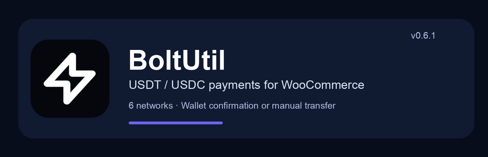
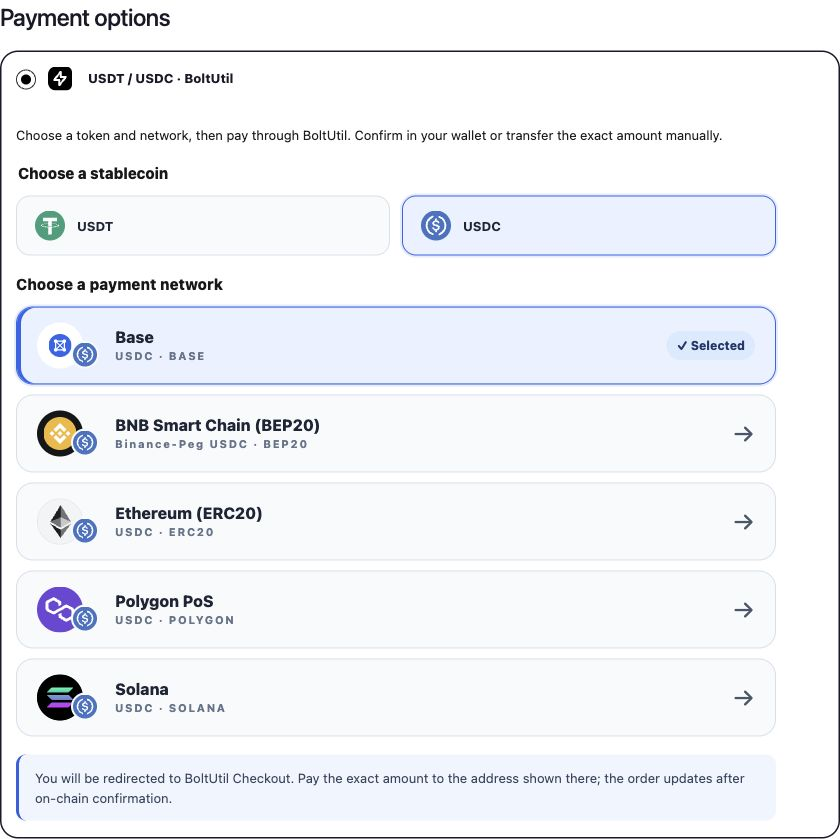

# BoltUtil — WooCommerce에서 USDT와 USDC 결제 받기

[English](../../README.md) · [简体中文](README.zh-CN.md) · [Español](README.es.md) · [Português](README.pt-BR.md) · [Русский](README.ru.md) · [Tiếng Việt](README.vi.md) · [Türkçe](README.tr.md) · [日本語](README.ja.md) · [한국어](README.ko.md) · [العربية](README.ar.md) · [Français](README.fr.md) · [हिन्दी](README.hi.md)

플러그인 **v0.6.1**은 WooCommerce를 BoltUtil Hosted Checkout에 연결합니다. 구매자는 코인과 네트워크를 선택하고 표시된 정확한 금액을 결제합니다. 지원되는 기기와 네트워크에서는 연결된 지갑에 주소와 금액이 자동 입력되며, 내용을 확인한 뒤 승인합니다. 수동 송금도 가능합니다. 자금은 판매자가 설정한 수신 지갑으로 직접 전달됩니다.

TRON, Ethereum, BNB Smart Chain, Polygon, Solana, Base 등 6개 네트워크를 지원합니다. USDT는 6개, USDC는 5개 네트워크로 총 11개 조합입니다. TRON은 USDT만 지원합니다. Base의 USDT는 Bridged USDT, BNB의 USDC는 Binance-Peg USDC입니다. 서비스, 판매자 지갑 및 플러그인에서 활성화된 조합만 표시됩니다.

## 설치 및 설정

v0.6.1 설치 ZIP을 내려받아 WordPress 플러그인 업로드 화면에서 설치합니다. 상점 통화를 USD로 설정하고 동일한 BoltUtil 판매자 계정에 LIVE API Key, 수신 지갑, 활성 Webhook을 구성한 뒤 저장합니다. 업데이트는 기존 주문과 인증 정보를 유지하며 USDC는 별도로 활성화해야 합니다.

**WordPress 7.0+ · PHP 7.4+ · WooCommerce 11.1+ · HTTPS · USD**

## 언어 및 결제 안내

플러그인 언어는 WordPress 로케일을 따릅니다. 판매자가 직접 입력한 문구는 자동 번역되지 않습니다. 매일 무료 할당량이 제공되며 구독에는 일일 주문 수 제한이 없습니다. 최신 혜택과 비용은 공식 사이트를 확인하세요. 결제 화면의 정확한 금액을 송금해야 하며 네트워크 수수료는 별도입니다. 상점으로 돌아온 것만으로 결제가 완료되지 않으며 서명과 결제 상태를 검증합니다.

데모 탐색은 무료지만 소액 구매에는 실제 자금이 사용됩니다. 플러그인은 GitHub에서 다운로드할 수 있으며 WordPress.org에 심사를 신청했습니다.

[Download v0.6.1](https://github.com/changye0413/boltutil-payments-for-woocommerce/releases/tag/v0.6.1) · [Live demo](https://shop-test.boltutil.com/) · [Integration guide](https://boltutil.com/woocommerce) · [Pricing](https://boltutil.com/pricing)

[Full setup and payment contract](../../README.md#configure-in-five-steps) · [Language guide](../I18N.md) · [Security](../../SECURITY.md)

