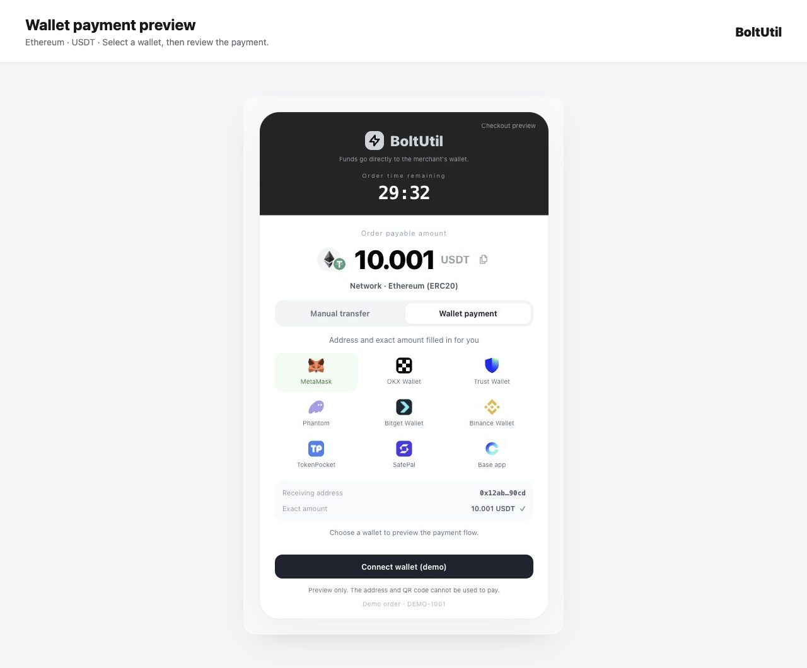
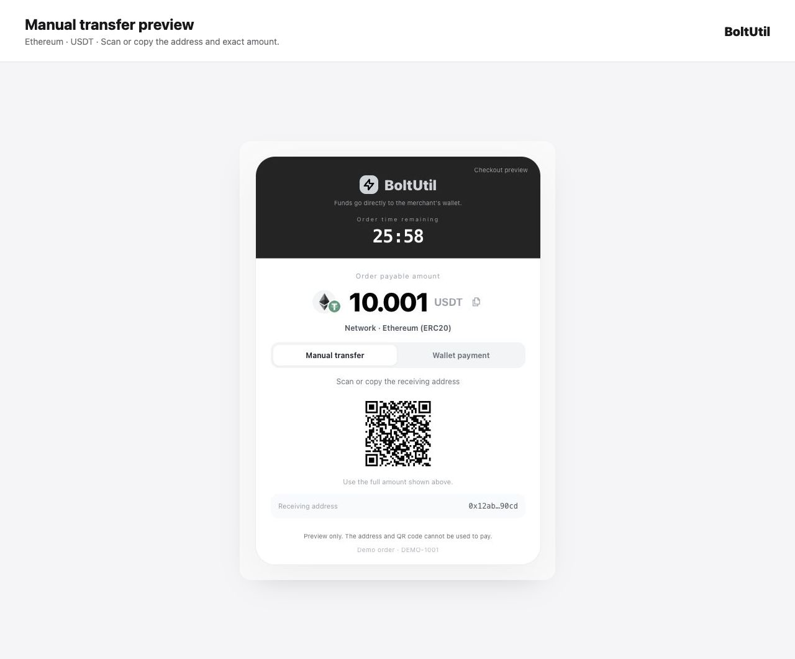

# BoltUtil — WooCommerce üzerinde USDT ve USDC kabul edin

[English](../../README.md) · [简体中文](README.zh-CN.md) · [Español](README.es.md) · [Português](README.pt-BR.md) · [Русский](README.ru.md) · [Tiếng Việt](README.vi.md) · [Türkçe](README.tr.md) · [日本語](README.ja.md) · [한국어](README.ko.md) · [العربية](README.ar.md) · [Français](README.fr.md) · [हिन्दी](README.hi.md)

**v0.6.1** eklentisi WooCommerce mağazanızı BoltUtil Hosted Checkout ile bağlar. Müşteri token ve ağ seçip gösterilen kesin tutarı öder. Desteklenen cihaz ve ağlarda bağlı cüzdan adresi ve tutarı doldurur; müşteri kontrol edip işlemi onaylar. Manuel transfer de kullanılabilir. Para satıcının tanımlı cüzdanına gider.

Altı ağ: TRON, Ethereum, BNB Smart Chain, Polygon, Solana ve Base. USDT altı, USDC beş ağda desteklenir: toplam on bir kombinasyon. TRON yalnızca USDT destekler; Base USDT, Bridged USDT; BNB USDC ise Binance-Peg USDC sürümüdür. Servis, satıcı cüzdanı ve eklenti ayarlarında etkin rotalar gösterilir.

## Kurulum ve yapılandırma

v0.6.1 kurulum ZIP dosyasını indirip WordPress eklenti yükleme sayfasında yükleyin. Mağaza para birimini USD yapın. Aynı BoltUtil satıcı hesabında LIVE API Key, alıcı cüzdanlar ve etkin Webhook oluşturup eklentide kaydedin. Güncelleme siparişleri ve kimlik bilgilerini korur; USDC ayrıca etkinleştirilir.

**WordPress 7.0+ · PHP 7.4+ · WooCommerce 11.1+ · HTTPS · USD**

## Diller ve ödemeler

Arayüz dili WordPress tarafından belirlenir. Satıcının özel metinleri otomatik çevrilmez. Günlük ücretsiz kota vardır; aboneliklerde günlük sipariş sınırı yoktur. Güncel haklar ve ücretler web sitesindedir. Checkout üzerindeki kesin tutarı ödeyin; ağ ücretleri ayrıdır. Mağazaya dönmek ödeme kanıtı değildir: eklenti imzayı ve ödeme durumunu doğrular.

Demo ücretsiz gezilebilir; küçük satın alımlar gerçek para kullanır. WordPress.org eklenti dizininde yayımlandı.

[Download v0.6.1](https://github.com/changye0413/boltutil-payments-for-woocommerce/releases/tag/v0.6.1) · [Live demo](https://shop-test.boltutil.com/) · [Integration guide](https://boltutil.com/woocommerce) · [Pricing](https://boltutil.com/pricing)

[Full setup and payment contract](../../README.md#configure-in-five-steps) · [Language guide](../I18N.md) · [Security](../../SECURITY.md)

[WordPress.org](https://wordpress.org/plugins/boltutil-payments-for-woocommerce/)

## Cüzdan ödemesi ve manuel transfer

Görseller demo verileri kullanır. Adres ve QR kod ödeme için kullanılamaz. Cüzdan kullanılabilirliği ağa ve cihaza bağlıdır.
