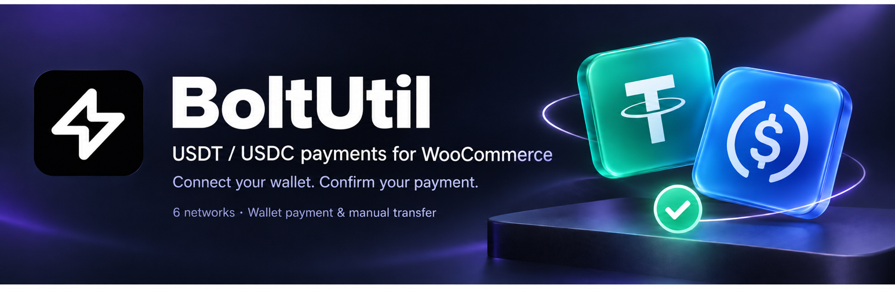

# BoltUtil — 在 WooCommerce 接收 USDT 和 USDC

[English](../../README.md) · [简体中文](README.zh-CN.md) · [Español](README.es.md) · [Português](README.pt-BR.md) · [Русский](README.ru.md) · [Tiếng Việt](README.vi.md) · [Türkçe](README.tr.md) · [日本語](README.ja.md) · [한국어](README.ko.md) · [العربية](README.ar.md) · [Français](README.fr.md) · [हिन्दी](README.hi.md)

插件 **v0.6.1** 将 WooCommerce 接入 BoltUtil 收银台。顾客先选币种，再选可用网络，随后核对准确金额付款。支持的设备和网络可连接钱包自动填入地址与金额，核对后确认；手动转账也保留。资金直接进入商户配置的收款钱包。

支持 TRON、Ethereum、BNB Smart Chain、Polygon、Solana、Base：USDT 六种网络，USDC 五种网络，共十一种组合。TRON 仅支持 USDT；Base USDT 为桥接版本，BNB USDC 为 Binance-Peg 版本。只有服务、商户钱包和插件设置均启用的组合才会显示。

## 安装与配置

下载 v0.6.1 的安装 ZIP，通过 WordPress 插件上传入口安装。商店货币设为 USD；在同一 BoltUtil 商户账号创建 LIVE API Key、配置收款钱包和有效 Webhook，再填入插件设置并保存。升级保留已有订单与密钥；USDC 需要商户自行启用。

**WordPress 7.0+ · PHP 7.4+ · WooCommerce 11.1+ · HTTPS · USD**

## 语言与付款说明

WordPress 决定插件界面语言，商户自行填写的结账名称不会自动翻译。每天有免费额度，订阅不限每日订单数，权益及费用以官网为准。必须按收银台准确金额付款，网络费用另计。返回商店不代表付款成功；插件核验签名回调及付款状态后才更新订单。

演示店可免费浏览，小额购买使用真实资金。当前是早期 GitHub 版本，真实付款回调闭环验收和 WordPress.org 审核尚未完成。

[Download v0.6.1](https://github.com/changye0413/boltutil-payments-for-woocommerce/releases/tag/v0.6.1) · [Live demo](https://shop-test.boltutil.com/) · [Integration guide](https://boltutil.com/woocommerce) · [Pricing](https://boltutil.com/pricing)

[Full setup and payment contract](../../README.md#configure-in-five-steps) · [Language guide](../I18N.md) · [Security](../../SECURITY.md)

